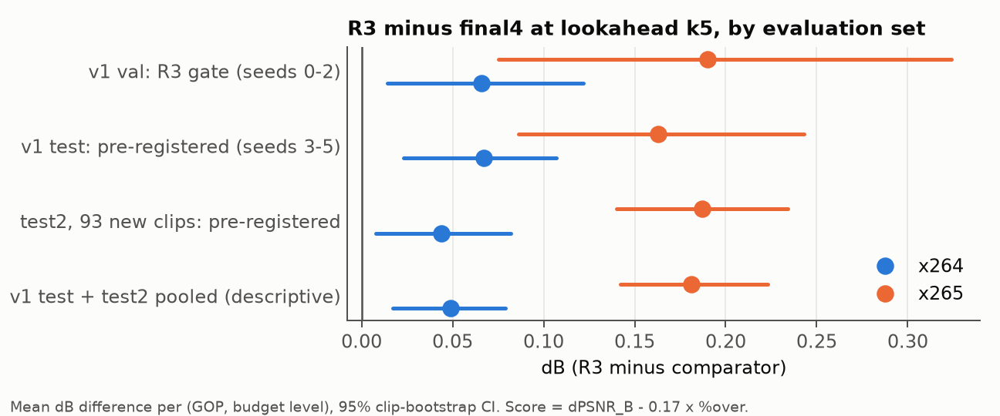
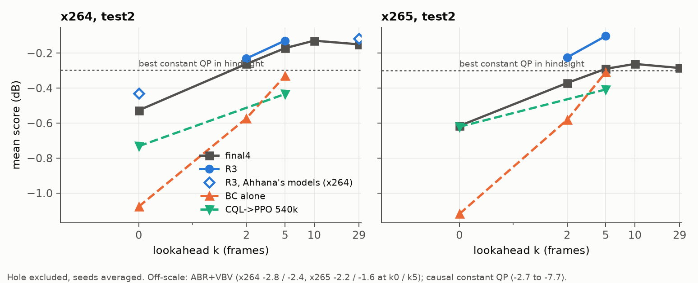
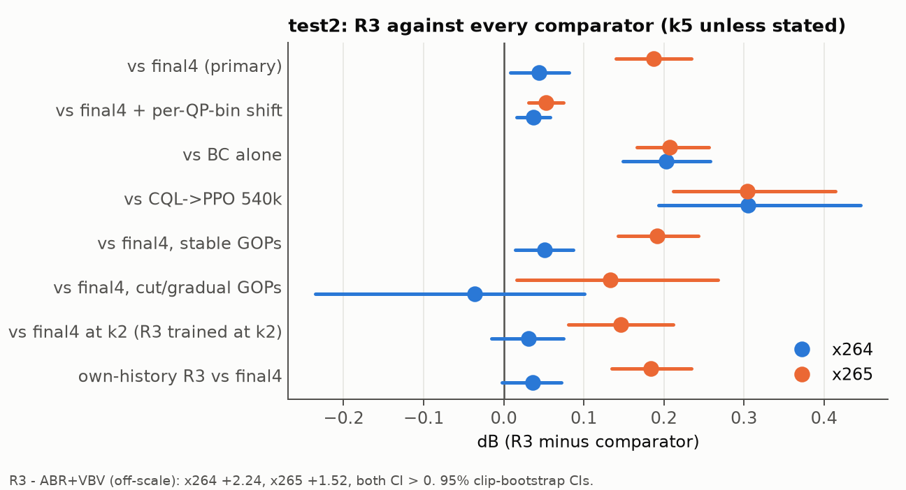
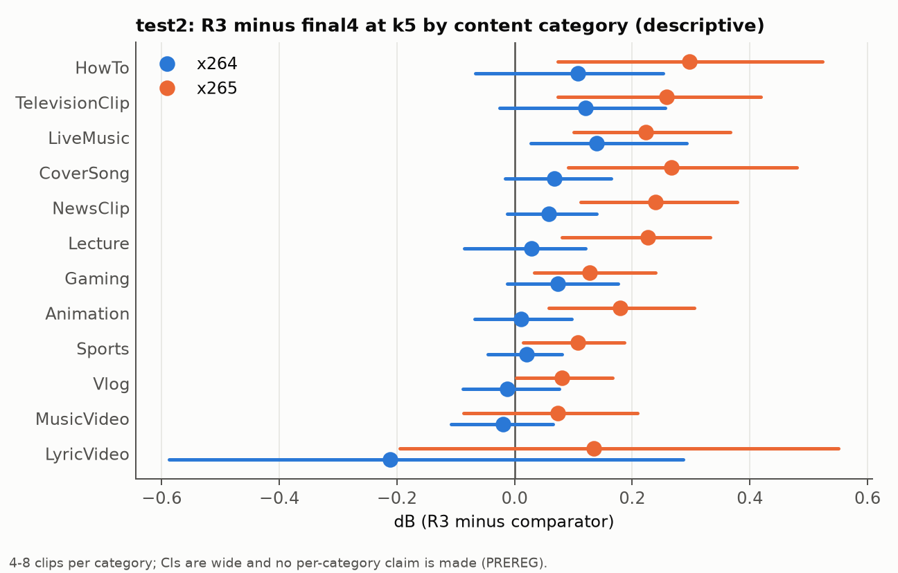
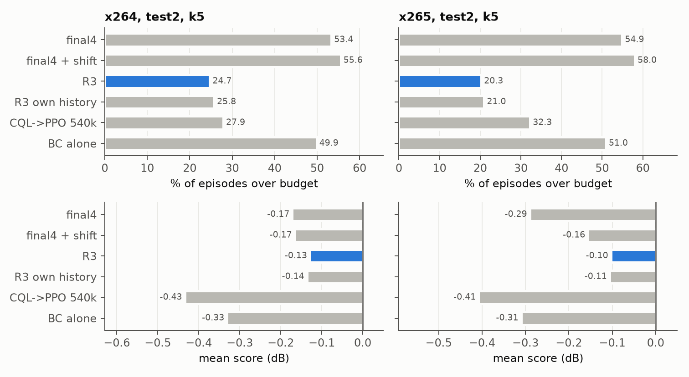
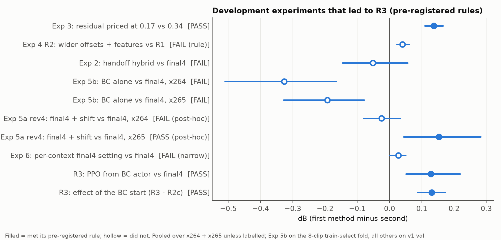
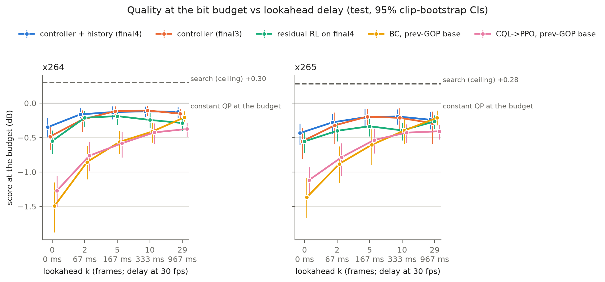
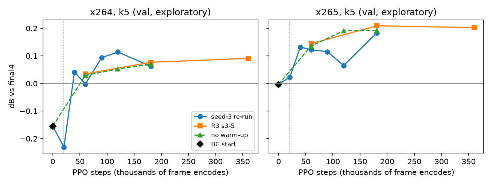

# Learned per-frame rate control under a hard GOP budget: results of the P2 workspace (data v1 + test2)

Author: Aayush (P2), with Claude. Status: FINAL, 2026-11-18; 11-19 addendum (capped Table I, luma stream rows;
sections 8, 9, 12, 14). Experimentation is closed.
This file is written to be read by a person or an agent drafting the team's final report. It is self-contained:
every number cites the report it comes from, and those reports are copied verbatim under `source_reports/`.
It supersedes `p2_data/docs/final-writeup-2026-11-16.md` (that file predates the PSNR-cap correction, the
final-week experiments, test2 and Ahhana's k0/k29 models).

Contents
1. One-paragraph summary
2. Problem, data, metric, baselines (what everything below is measured against)
3. Protocol (how claims were made)
4. Main result: R3 beats the tuned controller (v1 test + test2)
5. test2: a second, fresh held-out test set
6. How R3 wins, and what it does not do
7. The path to R3: every development experiment, positive and negative
8. Earlier findings that shaped the project (audit, metric, controller, learners)
9. Stream level (Exp 7)
10. Robustness and sensitivity
11. Where RL works and where it does not (the synthesis)
12. Caveats and threats to validity
13. Suggested claims for the final report, with strength; things not to claim
14. Provenance: where every number comes from; how to regenerate
15. Glossary

---

## 1. One-paragraph summary

On data v1 (109 clips, 320x180, 30-frame GOPs, x264 and x265) with leak-free clip-level budgets and a
quality-at-budget metric, no standalone learned controller (BC, CQL->PPO, Lagrangian PPO) beat our tuned causal
controller **final4**. What did beat it is **R3**: a PPO policy that adds a per-frame QP offset on top of final4,
whose actor is first initialised by behaviour cloning of an offline hindsight search, and which is trained at the
metric's own overshoot price. R3 beats final4 at lookahead k5 on both encoders, in one pre-registered pass on
v1 test (x264 **+0.067 dB** [+0.023, +0.107], x265 **+0.163 dB** [+0.086, +0.243]) and again on **test2**, a
fresh pre-registered set of 93 unseen YouTube-UGC clips (x264 **+0.044** [+0.008, +0.082], x265 **+0.187**
[+0.138, +0.235]). The RL step is what makes it work: BC alone loses to final4, and R3 beats BC alone by +0.20 to
+0.36 dB. R3 mainly wins by overshooting the budget less often (20-25 % of episodes vs ~55 % for final4). The gain
is robust on x265 (all GOP classes, 10 of 12 content categories, k2 and k5); on x264 it is small and confined to
stable GOPs. Lookahead beyond k5 adds nothing for any method; at the stream level a well-tuned rule matches RL.

---

## 2. Problem, data, metric, baselines

**Task.** Per-frame QP for a 30-frame GOP (IDR + 29 P) under a hard per-GOP bit budget B. The controller sees the
first-pass cost of the next k frames (lookahead k in {0, 2, 5, 10, 29}; k = 0 is strictly causal).

**Encoders (P1 settings, frozen 2026-11-03).** x264 (module x264/20250608, preset medium, IPPP, keyint 30,
scenecut / AQ / mb-tree / psy off, threads 1, forced QP via `qp=31 ipratio=10 pbratio=10`) and x265 4.1 (AQ and
cutree off). Bits = slice bits.

**Data v1** (`p2_data/docs/data-v1-README.md`): 109 clips (Xiph derf, UVG, YouTube UGC, Blender films, Netflix
Open Content; 15 high-frame-rate clips decimated to 25-30 fps; 6 spliced clips, train only), 1,042 GOPs, split by
source group: 625 / 152 / 265 GOPs (66 / 16 / 27 clips) train / val / test. Cut labels (stable / cut / gradual) from
two detectors + a blind two-reviewer review (kappa 0.64). 60 near-grayscale "flat" GOPs (14 clips) are excluded from
all scoring (their chroma PSNR saturates). Constant-QP curves QP 18-50 per GOP and encoder.

**Budgets** (`p2_data/scripts/budgets_v1.py`, `docs/budget-estimator-v1.md`): clip-level, 4 levels per GOP
(named by the constant QP whose clip-mean spend sets them: L24 / L30 / L36 / L42). A GOP's budget never comes from
its own encode (the pilot's budget did - see section 8).

**Metric (team decision 2026-11-09).** Score = dPSNR_B - 0.17 x (% over budget), in dB.
dPSNR_B = the episode's YUV PSNR minus the PSNR the GOP's constant-QP curve reaches at exactly B (interpolated).
0 = as good as a (continuous) constant QP that spends exactly the budget. Unused budget is not rewarded. 0.17 dB
per 1 % over is the price of overshoot. Every plane's per-frame PSNR is capped at 100 dB (Ahhana's correction,
2026-11-16; changes test results by <= 0.001 dB).

**"Hole" episodes.** At L24 some GOPs need a QP below 18 to spend B (budget above the curve's maximum); dPSNR_B is
undefined there. They are excluded from primaries and reported with them included as a check (never changes a
conclusion).

**Methods compared.**

| Name | What it is | Causal? |
|---|---|---|
| final4 | P2's online controller: causal base-QP estimate (budget + first-pass bits), per-frame rate-model feedback, plus the previous GOP's result in the same clip ("history"). Setting `1.0:6:1.0:2:3:4:1:1:1:0:3`, frozen 2026-11-11 | yes |
| final4 + shift | final4 + a fixed per-position QP shift chosen by the causal QP bin of frame 0 (Exp 5a); a non-RL upgrade | yes |
| ABR+VBV | the encoder's own rate control (rc-lookahead k), target margin tuned on val (x264 0.90, x265 0.93; Exp 10) | yes |
| cqp_est / cqp_best | one constant QP for the GOP from the causal estimator / the best constant QP in hindsight | yes / no |
| BC alone | classifier over 13 QP offsets on top of final4 + mean shift, trained on hindsight-search plans | yes |
| CQL->PPO 540k | Pavneet's offline-RL-then-PPO learner, rebuilt on the new metric with the previous-GOP base, 540k PPO steps | yes |
| R3 | PPO residual on final4: QP = round(final4's real QP + mean[t]) + offset (-6..+6), bit re-cap; actor initialised from BC alone; reward priced at 0.17; 180k steps with a 20k critic-only warm-up | yes |
| search | offline hindsight hill-climb over whole-GOP encodes (ceiling, not deployable) | no |

---

## 3. Protocol

- **Pre-registration.** Every experiment from 11-13 on wrote its pass/fail rule before results
  (`p2_data/exp_next/*/PREREG*.md`). Post-hoc analyses are labelled as such everywhere below.
- **Selection vs confirmation.** Development on an 8-clip train-select fold and on v1 val; v1 test used once
  (2026-11-16) for the frozen configuration; test2 built and pre-registered afterwards (2026-11-17).
- **Statistics.** Paired differences on identical (GOP, budget level, k); learned methods averaged over 3 seeds per
  episode first; 95 % percentile bootstrap over clips (2,000 resamples). "*" = CI excludes 0. No multiplicity
  correction; both encoders always reported.
- **One scorer.** Every method is rescored with one metric function on the same curves and budgets; stored scores
  were re-derived exactly before use. Evaluations are deterministic (re-runs reproduce rows exactly).
- **Seeds.** Development used seeds 0-2; the test pass and test2 use fresh seeds 3-5.

---

## 4. Main result: R3 beats the tuned controller

| R3 - final4, k5 (dB) | x264 | x265 | source |
|---|---|---|---|
| v1 val (R3 gate, seeds 0-2) | +0.066 [+0.014, +0.122] * | +0.190 [+0.075, +0.324] * | results_v1/next/exp4/r3_report.md |
| **v1 test, pre-registered (seeds 3-5)** | **+0.067 [+0.023, +0.107] *** | **+0.163 [+0.086, +0.243] *** | results_v1/final/report_test_cap.md |
| **test2, pre-registered (seeds 3-5)** | **+0.044 [+0.008, +0.082] *** | **+0.187 [+0.138, +0.235] *** | results_v1/test2/report_test2.md |
| v1 test + test2 pooled (descriptive) | +0.049 [+0.017, +0.079] * | +0.181 [+0.141, +0.224] * | results_v1/test2/report_test2.md |

- Every seed is positive on both test sets (v1 test x264 +0.03..+0.11, x265 +0.16..+0.17; test2 x264
  +0.02..+0.07, x265 +0.18..+0.20).
- Other comparisons on v1 test (k5): R3 - (final4 + shift) x265 +0.074 [+0.041, +0.105] *; R3 - CQL->PPO 540k
  +0.129 * (x264) / +0.199 * (x265); R3 - ABR+VBV +1.047 * / +0.711 *. Training to 360k adds nothing
  (R3 180k - 360k: -0.028 / +0.022, n.s.).
- Magnitude, for intuition: the hindsight search's ceiling on v1 test is about +0.30 dB on this metric and final4
  sits at about -0.1 to -0.2 dB at k5, so R3 closes roughly 15-35 % of the gap between final4 and the search
  (rough: mixes the search's hole-included mean with the capped, hole-excluded final4 mean; not pre-registered).

---

## 5. test2: a second, fresh held-out test set

**Why.** v1 test was used once, but all models and baselines were developed on v1. test2 asks whether the result
holds on clips nobody has seen. Evaluation only: nothing was trained, refit or tuned on test2.

**Data** (`p2_data/exp_next/test2/`, data under `data/t2/320x180`). 93 new YouTube-UGC clips, 12 categories
(about 8 each), one clip per uploader, no uploader shared with v1; 930 GOPs, 860 scored in 88 clips after the
flat-GOP rule. The same pipeline as v1 (decode, first-pass statistics, constant-QP curves, previous-GOP base
estimate, final4 / final3 runs); budgets from the v1-train fit. Cut labels with the v1 protocol (two detectors,
blind two-reviewer round 1: 80 % exact, 90 % cut vs not-cut, kappa 0.62; settlement; round-2 check): 788 stable,
69 cut, 3 gradual scored GOPs.

**Safeguards.** Pre-registration (`source_reports/exp_next/test2/PREREG.md`) frozen before any score existed.
Parity gate: 3 v1 test clips run through the test2 code path reproduce every stored v1 row exactly (R3 324/324,
CQL->PPO 648/648, final4 / final3, ABR, shift, PSNR cap; `results_v1/test2/parity.md` and the gate list at the end of
`report_test2.md`). Code changes sit behind a data-root switch whose default is v1. No deviation from the
pre-registration; amendments: none.

**Results** (`results_v1/test2/report_test2.md`; figures 2, 3, 5, 6):

| test2 (k5 unless stated) | x264 | x265 |
|---|---|---|
| **PRIMARY R3 - final4** | **+0.044 [+0.008, +0.082] *** | **+0.187 [+0.138, +0.235] *** |
| same, hole episodes included | +0.048 [+0.010, +0.087] * | +0.192 [+0.144, +0.239] * |
| stable GOPs | +0.051 [+0.014, +0.087] * | +0.192 [+0.144, +0.242] * |
| cut/gradual GOPs (72 GOPs, 36 clips) | -0.036 [-0.235, +0.101] | +0.133 [+0.012, +0.268] * |
| R3 - final4 at k2 (R3 trained at k2) | +0.031 [-0.015, +0.075] | +0.146 [+0.081, +0.208] * |
| R3 - BC alone, k5 / k2 | +0.203 * / +0.342 * | +0.207 * / +0.356 * |
| BC alone - final4, k5 | -0.159 * | -0.020 (n.s.) |
| R3 - (final4 + shift) | +0.037 [+0.016, +0.058] * | +0.053 [+0.032, +0.076] * |
| R3 - CQL->PPO 540k | +0.305 * | +0.304 * |
| R3 - ABR+VBV | +2.239 * | +1.518 * |
| R3 with its own history - final4 | +0.036 [-0.002, +0.072] | +0.184 [+0.133, +0.234] * |
| categories with CI > 0 (of 12; descriptive) | 1 (LiveMusic) | 10 |
| episodes over budget: R3 vs final4 | 24.7 % vs 53.4 % | 20.3 % vs 54.9 % |

**Ahhana's R3 at k0 and k29** (pre-registered secondary 10; x264 only; her models, same recipe, seeds 3-5; our
pipeline reproduces her stored val rows 1680/1680 per model before any test2 number was read):

| test2, x264 | R3 score | final4 score | R3 - final4 |
|---|---|---|---|
| k0 | -0.430 | -0.527 | +0.097 [+0.051, +0.149] * |
| k5 (ours, primary) | -0.129 | -0.172 | +0.044 [+0.008, +0.082] * |
| k29 | -0.118 | -0.150 | +0.032 [+0.005, +0.061] * |

So on x264, R3 beats final4 at every lookahead tested; its edge is largest at k0, where final4 is weakest.
(R3 at k0 - our BC alone at k0 = +0.647 * and - CQL->PPO at k0 = +0.302 *; that BC is ours, not her BC start.)

---

## 6. How R3 wins, and what it does not do

- **It overshoots less.** R3 goes over budget on 20-25 % of episodes vs 53-55 % for final4 (test2 and v1 test),
  and lands slightly under on average (signed spend error about -1.5 to -2 %). Under this metric, going over costs
  2-3x more than going under (Exp 1: the local R-D slope is 0.036-0.064 dB per 1 %, vs the 0.17 dB per 1 % price),
  so the optimal over-rate is 21-37 %; final4 sits at 43-65 %. R3 moved to the optimum.
- **It also spends the bits slightly better.** Quality for the bits (A, the pre-penalty part) is higher for R3 than
  for final4 (v1 test A: x264 +0.131 vs +0.067, x265 +0.121 vs -0.030).
- **It does not exploit lookahead more than final4 does.** R3's gain at k2 is smaller than at k5 (x264 n.s.), and
  Ahhana's k29 model gains less over final4 than her k0 model. The k-curves of all methods are front-loaded: k2
  gives most of the lookahead gain and nothing is gained past k5 (figure 2, figure 8).
- **It does not specifically fix scene cuts.** The gain is mostly on stable GOPs; on cut/gradual GOPs it is n.s. on
  x264 in both test sets and n.s. on x265 v1 test (positive on x265 test2).
- **Its own history costs nothing material.** Running R3 on its own previous-GOP result (deployment-faithful)
  instead of final4's stored one changes the score by -0.004 [-0.010, +0.002] on v1 test pooled
  (`results_v1/next/fw/seqhist_test.md`) and by -0.008 / -0.003 on test2.

---

## 7. The path to R3: every development experiment, positive and negative

Full ledger with one row per experiment: `tables/experiment_ledger.csv`. In order:

| Exp | Question | Result | Verdict | Source |
|---|---|---|---|---|
| 0 | Is the residual pipeline sound? | train parity 40/40 exact; deterministic evals; reward = dPSNR_B - final4's - 0.34 x %over | checks passed | exp_next/exp0/CHECKS.md |
| 1 | Where does final4 lose to the search? | allocation headroom (search A - final4 A) +0.37 dB; causal methods differ from final4 mostly in spend error; optimal over-rate 21-37 % vs final4's 43-65 % | led to residual design + metric-priced reward | next/exp1/headroom.md |
| 2 | Learner for the first frames, final4 for the last m? | hybrid - final4 -0.052 [-0.146, +0.056]; longer handoffs under-spend | FAIL | next/exp2/report.md |
| 3 | Price the residual's overshoot at 0.17 (the metric) not 0.34? | +0.137 [+0.109, +0.166] pooled; but still vs final4 x264 -0.071 *, x265 -0.003 | PASS (becomes R1) | next/exp3/report.md |
| 4 R2 | Wider offsets (-6..+6) + final4-state features? | R2 - R1 +0.040 * pooled but gain only at k5, one seed negative; ties final4 (+0.003) | FAIL (rule) | next/exp4/r2_report.md |
| 5 / 5a | Per-frame shift on final4 from search plans | per-level shift needs the budget level (clip-level hindsight); causal per-QP-bin version fails the rule at k0; post-hoc k5: x265 +0.153 [+0.044, +0.283] *, x264 -0.025 | x265-only non-RL upgrade | next/exp5/shift_qbin.md, shift_val_rev4.md |
| 5b | BC alone (imitate the search's offsets on final4) | BC - final4 x264 -0.327 *, x265 -0.193 *; offline fit fine, closed-loop drift (+0.8..+1.4 QP at k0) misses the budget | FAIL (loses) | next/exp5/bc_fold.md |
| 4 R3 | PPO started from the BC actor (+ bit cap, warm-up, level flag masked) | R3 - final4 +0.128 [+0.050, +0.216] * pooled; BC-start effect (R3 - same without BC) +0.131 * | PASS: first learner to beat final4 | next/exp4/r3_report.md |
| 6 | Pick final4's setting per context? | +0.027 [-0.000, +0.050] vs a +0.03 bar | FAIL (narrow) | next/exp6/gate.md |
| 7 | Stream level (section 9) | RL - retuned rule n.s. on test | primary not met | final/report_test_cap.md |
| 10 | Encoder ABR+VBV with a tuned target margin | margin 0.90 / 0.93 helps (+0.3 dB) but stays ~1 dB below final4 | fair codec baseline | next/exp10/abr_margin.md |
| o[2] | Does the hindsight "level != 24" input flag matter? | at evaluation <= 0.02 dB; BC / R3 trained without it | no material dependence | next/o2/o2_report.md |

Key reading: two ingredients did the work. (1) Pricing overshoot at the metric's own rate (Exp 3). (2) Starting PPO
from an imitation policy (R3; +0.131 over the same setup from the standard init). Neither BC alone nor RL from
scratch beats final4; the combination does.

---

## 8. Earlier findings that shaped the project (11-03 to 11-12)

These predate the pre-registered round; numbers on the "old" scale are in points, not dB.

1. **Audit of the pilot pipeline** (`p2_data/docs/review-paper-draft-2026-11-03.md`). C1: the budget was the GOP's
   own constant-QP spend, which leaks the GOP's cost; U1: the base QP was the hindsight QP; C2: cut / flash / fade
   flags looked 2-4 frames ahead even at "k = 0". A decoupled budget lowered the "causal" scores (Lagrangian k0
   4.67 -> 3.37 x264, 4.12 -> 3.45 x265; `results_v1/x264_arm_compare.md`, `x265_arm_compare.md`). The full pipeline
   was re-run on data v1 (BC, CQL->PPO, Lagrangian PPO, k 0-29, 3 seeds, both encoders; ~1,400 CPU-h).
2. **The old metric rewarded unused budget** (`results_v1/rescore_budget/`). Most of every method's "bit saving"
   was budget left unspent. A residual policy "improved" the old score by +2.8 by raising QP on almost every frame,
   i.e. 1.23 dB worse quality at the budget (`results_v1/res_compare_x264.md`). -> the dPSNR_B metric.
3. **A strong causal baseline matters.** Retuning the controller under the new metric (final3) and adding
   previous-GOP history (final4) moved the bar by ~0.4-0.5 dB, past every standalone learner
   (`results_v1/w5/ctrl_versions.md`). Previous-GOP history is the strongest k = 0 feature found (base-QP error
   3.7 -> 2.4 QP; `results_v1/gates/base_prev_*.md`). final4 beats ABR+VBV by about +1.3 to +1.5 dB (x264) and
   +0.8 to +1.0 dB (x265) (`results_v1/w5/abr_dpsnr.md`).
4. **No standalone learner beats final4** (`results_v1/lfq_compare_{x264,x265}_final4.md`,
   `results_v1/w5/w5_numbers.md`). BC, CQL->PPO and Lagrangian PPO on the new metric sit 0.1-2.5 dB below final4 at
   k <= 5 and approach it only at k29. The closest: CQL->PPO at 540k steps ties final4 on x265 test (+0.003 n.s.)
   and is below on x264 (-0.069 *) (`results_v1/w5/gates_40.md`).
5. **Things tried that did not help:** an inference-time budget shield (lowers every method's score;
   `results_v1/x264_orig_shield_val.md`); potential-based reward shaping (helps CQL->PPO at k0 on the old metric, hurts
   Lagrangian; `results_v1/shaping_compare_x264.md`); a shared set-attention encoder for BC across k (gate fail;
   `results_v1/w5/gates_35_36.md`); a residual trained only on tight budgets (gate fail; same file); richer
   first-pass statistics (better per-frame bit prediction, no gain for the GOP-level decision;
   `p2_data/docs/fp-stats-gate.md`).
6. **Lookahead.** For final4 the k-curve is front-loaded: on v1 test x264 k2 - k0 = +0.185 *, k5 - k2 = +0.034 *,
   k10 / k29 - k5 ~ 0 (`results_v1/w5/w5_numbers.md`). Lookahead helps cut GOPs about twice as much as stable ones
   (k5 - k0: +0.38 vs +0.18 dB; `results_v1/w3/class_kcurves_*.md`). See figure 8.
7. **Capped version of the v1 test k-curve (11-19).** `w5_numbers.md` / `abr_dpsnr.md` predate the 100 dB PSNR cap.
   `results_v1/final/table1_cap.md` (`exp_next/final/table1_cap.py`, rescoring only) gives the same table with the
   cap, in the same convention (hole episodes included): one GOP's curve changes, so every cell moves by at most
   +0.002 dB and final4's row not at all; ABR+VBV x264 range -1.52 to -1.64 (was -1.65); the "share of the search's
   gain" moves by at most 1 point. It also lists the hole-excluded version. Use it for any k-curve table in the
   report (the final report's Table I).

---

## 9. Stream level (Exp 7)

Reproduction and extension of Pavneet's stream policies (his D34/D35) and Sara's PID-Lagrangian (P4):
budgets over a stream of GOPs, a policy picks per-GOP budgets.

- All 24 of Pavneet's stream policies and his rule reproduce exactly on val (`results_v1/next/exp7/repro_*.md`).
- Retuning the rule (past its grid edge) makes it much stronger: same-clip 8-GOP val score x264 -0.623 -> -0.500,
  x265 -0.453 -> -0.294 (`results_v1/next/exp7/select_*.md`).
- Test, pre-registered primary (selected RL policy - retuned rule, same-clip 8-GOP streams): x264 -0.026
  [-0.091, +0.040], x265 +0.050 [-0.009, +0.148] -> **not met** (`results_v1/final/report_test_cap.md`). RL wins on
  spliced "mixed" streams (+0.51 / +0.47 *) and on x265 16/32-GOP streams (+0.10 *).
- Hierarchy (x264, descriptive; `results_v1/next/exp7/part2_x264_test.md`): final4 inside each GOP adds +0.35 to
  +0.71 dB over constant-QP GOPs; retuned rule + final4 is best (+0.36); RL + final4 is 0.39 dB below it *.
- **Luma PSNR (11-19).** The rows above use the 6:1:1 YUV PSNR of Pavneet's stream code; his later stream and live
  rows use luma PSNR of pooled MSE. Rescored in luma from the stored per-GOP QPs, no encodes
  (`results_v1/final/exp7_luma.md`, `exp_next/exp7/luma_rescore.py`; his D50 definition, luma tables identical to
  his): primary policy - rule A x264 -0.045 [-0.136, +0.046], x265 +0.073 [-0.006, +0.207] (still not met); mixed
  streams +0.60 * / +0.55 *; policy - his rule as reported, mixed +0.22 * / +0.29 *. Over-budget rates do not depend
  on the PSNR convention. The 16/32-GOP film rows have no per-frame luma and stay YUV.
- **Sara's PID-Lagrangian PPO in luma (11-19).** Her equal-reliability comparison (rule at margin 0.96 vs her
  constrained PPO runs, v1 test, L2 and L0; `p4/README.md`) rescored the same way (`results_v1/final/pid_luma.md`,
  `exp_next/exp7/pid_luma.py`; the YUV rerun reproduces her README exactly): x264 +0.14 to +0.17 (YUV) ->
  **+0.18 to +0.20** (luma), x265 +0.18 to +0.25 -> **+0.22 to +0.28**, all CIs > 0. Luma gaps are 10-25 % larger
  than YUV ones (as Pavneet found for his rows: chroma PSNR sits near its cap on v1, so the 6:1:1
  weighting dilutes luma differences).
- Reading: at stream level without a network model, "lookahead helps", not "RL helps". Pavneet's live-stream work
  (network + buffer) is reported separately in `pavneet_handoff/` with a different metric.

---

## 10. Robustness and sensitivity (final week; exploratory unless stated)

Source: `results_v1/next/fw/` (report_fw_val.md, seqhist_*.md, metric_sens_*.md).

- **k-curve on val:** R3 - final4 x264 k2 +0.035 n.s. / k5 +0.077 *; x265 k2 +0.152 * / k5 +0.209 *.
  R3 - BC alone: k2 +0.276 * / +0.307 *, k5 +0.231 * / +0.212 *.
- **Own history** (R3 fed its own GOP n-1 result; post-hoc on test, approved): R3 - final4 x264 +0.071 *, x265
  +0.151 * (the pre-registered +0.067 / +0.163 stand).
- **Learning curve:** training is deterministic; the end of warm-up equals BC alone exactly; 3-seed means improve
  60k -> 180k (+0.034 -> +0.077 x264, +0.145 -> +0.209 x265); single-seed curves are noisy; 360k adds nothing on
  test. Figure 7.
- **No critic warm-up:** no detectable effect (pooled +0.012 [-0.007, +0.029]).
- **Overshoot price** (post-hoc re-scoring of the sealed test rows at lambda 0..0.68; `metric_sens_test.md`):
  x265 R3 - final4 positive at every lambda (+0.088 * at 0 ... +0.388 * at 0.68); x264 +0.010 n.s. at 0,
  +0.038 * at 0.085, +0.067 * at 0.17, +0.240 * at 0.68. R3's x264 edge depends on overshoot being priced;
  its x265 edge does not.
- **Level flag o[2]:** see section 7.

---

## 11. Where RL works and where it does not

**Works**
- As a **residual on a strong causal controller**. Every standalone learner lost to final4.
- When **started from imitation** of a hindsight search and then **fine-tuned with PPO**. BC alone loses (closed-loop
  drift); the PPO step turns it into a win (+0.20 to +0.36 dB over BC, all CIs > 0, both encoders, both test sets).
- When the **reward is the evaluation metric** (overshoot priced at 0.17, not 2x).
- By **landing the budget better** (fewer overshoots) and slightly better allocation.
- **Strongly on x265** (+0.16 to +0.19 dB on two independent test sets; all classes; most categories; k2 and k5).
- On x264, **at every lookahead tested** (k0 +0.097, k5 +0.044 / +0.067, k29 +0.032), but small.

**Does not work (or not shown)**
- **Standalone learners** (BC, CQL->PPO, Lagrangian PPO), including longer training and shaped rewards.
- **Pure imitation** of the hindsight search (BC alone).
- **Scene cuts on x264**: no gain on cut/gradual GOPs; lookahead's value at cuts is already taken by final4.
- **Using more lookahead**: nothing past k5 for any method.
- **Stream level** without a network model: a retuned rule matches RL.
- **Handoffs, per-context setting selection, budget shields, set-attention encoders**: all negative or null.

---

## 12. Caveats and threats to validity

- final4 and the ABR margins were tuned on v1 val; learners were selected on v1 val (favours val numbers, not test).
- final4's and the 540k learner's v1 test rows existed before the 11-16 test pass; Pavneet's stream results had
  been measured on v1 test; Elephants Dream and Tears of Steel are v1 test clips.
- R3 at k0 / k29 exists only for x264 (Ahhana's models) and only on test2; at k2 / k5 for both encoders.
- test2 is UGC only (no Xiph / Blender / Netflix sources), so its content mix differs from v1 test.
- Cut/gradual slices are small (v1 test 52 scored GOPs; test2 72 GOPs in 36 clips); category slices have 4-8 clips each.
- x264's ABR margin (0.90) is at its grid edge.
- One resolution (320x180), one GOP length (30), one encoder setting per codec. Per-GOP (per-frame) results are
  PSNR only: VMAF there needs re-encoding every episode's per-frame QPs and was not done (stated limitation; agreed
  with Pavneet 11-19). Pavneet's VMAF check (VMAF 3.0.0 built on CARC) covers only the stream and live levels,
  where each GOP is one constant QP (`pavneet_handoff/`).
- PSNR conventions differ by level: per-GOP = YUV 6:1:1 PSNR averaged over frames (every plane capped at 100 dB);
  stream / live = luma PSNR of pooled MSE. The Exp 7 and PID rows have luma versions (section 9).
- Numbers from the older reports in section 8 use different conventions (hole included, uncapped PSNR, or the old
  points scale); compare only within a table. Example: final4 x264 test k5 is -0.129 in w5_numbers.md (hole
  included) and -0.107 in report_test_cap.md (hole excluded, capped); the capped, hole-included k-curve table is
  `results_v1/final/table1_cap.md` (section 8 item 7).

---

## 13. Suggested claims for the final report

| Claim | Strength | Evidence |
|---|---|---|
| R3 beats the tuned causal controller final4 at k5 on both encoders | strong: pre-registered, two independent test sets, every seed | sections 4-5, figure 1 |
| The RL fine-tuning step adds over imitation alone | strong: +0.20 to +0.36 dB, both encoders, both k, val and test2 | sections 5, 7, 10 |
| R3 wins mainly by overshooting less (and slightly better allocation) | strong | section 6, figure 5 |
| On x265 the gain is broad (classes, categories, k2/k5) | strong on test2, consistent on v1 test | section 5, figure 6 |
| On x264 the gain is small and on stable GOPs | moderate (cut slice n.s. on both sets) | section 5 |
| Standalone learners do not beat a well-tuned rule-based controller | strong (many runs, both encoders) | section 8 |
| Lookahead gains saturate by k5 | strong for final4; consistent for learners | sections 6, 8 |
| On x264, R3 beats final4 at k0 and k29 too | moderate: descriptive secondary, test2 only, x264 only | section 5 |
| Stream level: RL is not better than a retuned rule on real streams | moderate (pre-registered primary not met) | section 9 |

**Do not claim:** that RL handles scene cuts better (not shown on x264; small slices); that R3 uses lookahead
better than final4; per-category effects; any gain from training past 180k; that the hindsight search is reachable
(R3 closes only a fraction of the gap); x264 robustness to a zero overshoot price.

---

## 14. Provenance and regeneration

- `source_reports/results_v1/...` are verbatim copies (2026-11-18; `final/table1_cap.md`, `exp7_luma.md`,
  `pid_luma.md` added 11-19) of the workspace reports
  (`/scratch1/aayushso/ee599/results_v1/...`). Raw rows (pkl / parquet) and data are not in git (team convention).
- `tables/key_numbers.csv`: every number in figures 1-6 with the source file and the exact source line it was
  parsed from. `tables/experiment_ledger.csv`: one row per experiment.
- Figures 1-6: `python report_pack/scripts/make_figures.py` (reads only `source_reports/`). Figures 7-8 are copies
  of `results_v1/next/fw/fig_curve.png` and `results_v1/figures/w5_quality_vs_delay.png`.
- Code that produced the reports (in git under `p2_data/`): v1 test pass `exp_next/final/report.py`; test2
  `exp_next/test2/report.py`, `eval_t2.py`, `eval_ahhana.py`; development experiments `exp_next/exp*/`; final week
  `exp_next/fw/`; controller `scripts/controller_real.py`; metric and learner comparisons `scripts/lfq_compare.py`,
  `scripts/w5_numbers.py`; 11-19 rescorings `exp_next/final/table1_cap.py`, `exp_next/exp7/luma_rescore.py`,
  `exp_next/exp7/pid_luma.py`. RL environment and training: Pavneet's pipeline as modified for v1, in git as
  `pavneet_pipeline/` (rclib/env.py, config.py, policies.py and experiments/rl.py there are identical to the versions
  that produced every result here, including the residual arm used by R3). Not in git: a data-root switch for test2
  in three `tools/*_infos.py` files of the local copy.
- Pre-registrations: `source_reports/exp_next/final/PREREG.md` (v1 test), `source_reports/exp_next/test2/PREREG.md`
  (test2); the others under `p2_data/exp_next/*/PREREG*.md`.
- Full experiment log with dates and job IDs: `p2_data/docs/EXPERIMENTS.md`, `p2_data/docs/p2-tracker.md`.

## 15. Glossary

- **k** - lookahead: frames ahead whose first-pass cost the controller sees. k0 = strictly causal.
- **L24 / L30 / L36 / L42** - budget levels (clip-mean spend of constant QP 24 / 30 / 36 / 42).
- **dPSNR_B** - PSNR minus the constant-QP PSNR at exactly the budget. **score** = dPSNR_B - 0.17 x %over.
- **A / E-P** - decomposition of the score: A = quality for the bits actually spent; E-P = the effect of
  spending error and the overshoot penalty.
- **hole** - L24 episodes whose budget exceeds the GOP's QP-18 spend (dPSNR_B undefined).
- **final3 / final4** - the controller without / with previous-GOP history; final4 is the frozen baseline.
- **R1 / R2 / R2c / R3** - residual-RL rungs: R1 = residual at lambda 0.17; R2 = + wider offsets and features;
  R2c = R3's setup without the BC start; R3 = PPO from the BC actor.
- **mean[t]** - fixed per-position QP shift distilled from the search plans (Exp 5).
- **BC alone** - the imitation classifier deployed on final4 without RL.
- **test2** - the second held-out set (93 UGC clips) built 2026-11-17.
- **\*** - 95 % clip-bootstrap CI excludes 0. **n.s.** - it does not.
