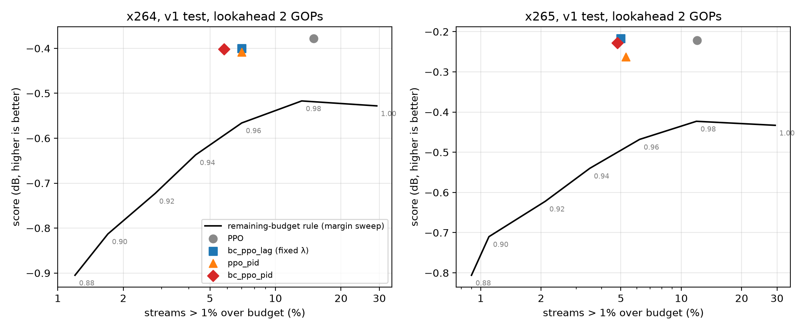

# P4: Stream-level RL, baseline fairness and budget handling

**Owner:** Sara Pirasteh · **Branch:** `sara-p4`

- **Part 1:** per-length retuning of the stream rule (leave-one-film-out)
- **Part 2:** PID-Lagrangian PPO for budget reliability


## Part 1: per-length retuning of the stream rule (leave-one-film-out)

### Question
Pavneet's D35 fresh-film results show RL beating the remaining-budget rule by more on 16/32-GOP
streams than on 8-GOP ones. But the rule was tuned only on 8-GOP v1 streams. Is the long-stream
gain real, or is the rule just mistuned at longer lengths?

### Method
- Streams of N = 16 or 32 consecutive GOPs from the Elephants Dream (ED) and Tears of Steel (ToS)
  segments in `pavneet_handoff/artifacts/<codec>/fresh` (6 segments per film).
- **Leave-one-film-out:** grid-search the rule on one film, evaluate on the other, then swap.
  The test film is never used for tuning.
- Grid: margin {0.98, 1.00, 1.02} × QP per doubling {4.5–8.0} × prior weight {0.1–200}
  (231 settings). Widened three times until the optimum was interior or the score was flat at the
  edge (neighbouring settings within 0.011 dB).
- Policies (PPO, BC→PPO; L = 0 and 2; 3 seeds averaged) are Pavneet's D34 models, unchanged.
- 95 % cluster bootstrap over film segments (`stream_rl.cboot`).

### Results: policy vs the retuned rule (dB, test film)

| | ahead | CI excludes 0 | N=32, L=2, ToS |
|---|---|---|---|
| PPO, x264 | 8/8 | 6/8 | +0.122 |
| PPO, x265 | 8/8 | 8/8 | +0.102 |
| BC→PPO, x264 | 7/8 | 2/8 | −0.045 |
| BC→PPO, x265 | 7/8 | 3/8 | −0.132 |

Full per-case output: `lofo_x264.txt`, `lofo_x265.txt`.

### Findings
1. **Plain PPO's long-stream gain is real.** It beats the retuned rule in 16/16 cases
   (+0.07 to +0.39 dB; 14/16 CIs exclude 0).
2. **Part of the reported gain came from the 8-GOP tuning.** On ToS at 32 GOPs, retuning cut PPO's
   lead by up to half (x265 L=0: +0.40 → +0.20 dB).
3. **The pre-registered BC→PPO mostly does not hold up** (5/16 significant), and it falls behind
   the rule in the same case on both codecs (32 GOPs, L=2, ToS). Hypothesis, not tested: the BC
   start anchors the policy to 8-GOP hindsight plans.
4. The rule's prior weight is not identifiable from 3 segments: the optimum is ≤ 0.5 when tuned on
   ED and ≥ 24 on ToS. Retuning improved the rule on the held-out film in only 10 of 16 cases.

### Caveats
- Only 2 films, 6 segments each, so the CIs are wide.
- `ed_s*` / `tos_s*` clips are in v1's **test** split, so these films are not "unseen" in the
  sense of being outside v1. The segments here are longer, and no policy was trained or tuned on
  them.

## Part 2: PID-Lagrangian PPO for budget reliability

### Question
Plain PPO beats the rule on quality but goes >1 % over budget on 12–15 % of v1 test streams. For live
streaming, overshoot is what hurts. Can RL hit a chosen reliability level without hand-tuning the
over-budget penalty λ, and does it still beat the rule *at equal reliability*?

### Method
- Pavneet's D34 stream env (8-GOP v1 streams), reward `dPSNR_B − λ × %over`.
- **PID-Lagrangian** (`train_pid.py`): after every PPO rollout, `e = (share of the last 1000 streams
  >1 % over) − target`, `I = max(0, I + e)`, `λ = 0.17 + max(0, Kp·e + Ki·I)`; target 5 %, Kp 2, Ki 0.05.
  The 0.17 floor keeps the penalty at least the metric's own.
- Variants: `ppo_pid` (from scratch; L = 0, 2) and `bc_ppo_pid` (BC start, as Pavneet's `bc_ppo_lag`; L = 2).
  2M steps, 3 seeds, both codecs.
- **Fair baseline** (`rule_margin_sweep.py`): sweep the rule's margin 0.88–1.00 to trace its quality vs
  over-rate curve; compare RL to the rule at margin 0.96, which overspends on ~6–7 % of test streams
  like the constrained policies. Paired 95 % cluster bootstrap.

### Results (v1 test)

| | x264 L=2 | x264 L=0 | x265 L=2 | x265 L=0 |
|---|---|---|---|---|
| over rate: rule@0.96 / RL | 7 % / 6–7 % | 7 % / 8 % | 6 % / 5 % | 6 % / 5 % |
| ppo_pid vs rule@0.96 | +0.158 [+0.120, +0.200] | +0.136 [+0.076, +0.212] | +0.205 [+0.164, +0.266] | +0.180 [+0.100, +0.291] |
| bc_ppo_pid vs rule@0.96 | +0.165 [+0.118, +0.218] | – | +0.240 [+0.181, +0.321] | – |
| bc_ppo_lag vs rule@0.96 | +0.165 [+0.118, +0.220] | +0.170 [+0.103, +0.267] | +0.251 [+0.193, +0.333] | +0.188 [+0.085, +0.327] |
| **bc_ppo_pid vs bc_ppo_lag** | −0.001 [−0.008, +0.007] | – | −0.012 [−0.018, −0.005] | – |



Per-run logs: `pid_*.txt`, `bcpid_*.txt`. Full tables: `report_pid_*_test.md`, `rule_margin_*.txt`.

### Findings
1. **At equal budget reliability, constrained RL beats the rule by 0.14–0.25 dB** on both codecs
   (all CIs > 0). Every RL point lies above the rule's whole margin curve.
2. **Given only a target (≤ 5 % of streams over), the PID matches a hand-picked λ within 0.012 dB**
   (tie on x264; 0.012 dB behind on x265, CI excludes 0) and finds λ ≈ 0.36–0.48 itself, near the hand-picked 0.34.
3. **The BC start matters more than how λ is set:** from scratch, the PID was 0.04 dB behind on x265.
4. Constrained policies halve PPO's overspends (12–15 % → 5–7 %) for 0–0.04 dB. Like Aayush's
   frame-level finding, a penalty above the metric's 0.17 trades a little score for reliability.

### Caveats
- 8-GOP v1 streams only; BC-start PID run at L = 2 only.
- Train/test gap in reliability: ~5 % over during training became 6–7 % on x264 test.
- Single PID setting (Kp 2, Ki 0.05, target 5 %); no sweep over targets.

## How to run
From `p4/` (PowerShell). Takes a few minutes per codec on a laptop, no cluster needed.

**Part 1** (LOFO retuning):
```powershell
$env:RC_V1="1"; $env:RC_CODEC="x264"
$env:RC_WORK="<repo>\pavneet_handoff\artifacts\x264\fresh"
$env:RC_V1WORK="<repo>\pavneet_handoff\artifacts\x264\v1"
python -u stream_rule_lofo.py | Tee-Object lofo_x264.txt
```

**Part 2** (`RC_WORK` = a copy of `pavneet_handoff\artifacts\<codec>\v1` outside the repo):
```powershell
python -u train_pid.py --look 2 --seed 0          # ppo_pid, ~15-30 min
python -u train_pid.py --bc --look 2 --seed 0     # bc_ppo_pid
python -u rule_margin_sweep.py                    # rule curve + equal-reliability CIs
python plot_tradeoff.py                           # tradeoff_L2.png
```