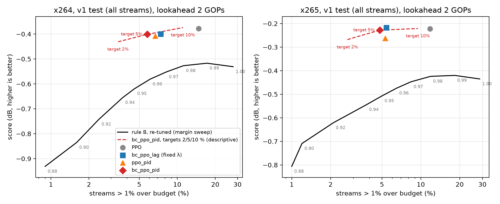

# P4: Stream-level RL, baseline fairness and budget handling

**Owner:** Sara Pirasteh · **Branch:** `sara-p4` (merged into `main`)

- **Part 1:** per-length retuning of the stream rule (leave-one-film-out)
- **Part 2:** PID-Lagrangian PPO for budget reliability
- **Part 3:** do the constrained policies hold on long streams?
- **Part 4 (current result for the report):** PID vs the *re-tuned* rule, margin matched on val

```
p4/
├── README.md
├── stream_rule_lofo.py     Part 1
├── train_pid.py            Part 2: PID-Lagrangian PPO (--bc for a BC start, --target for the over-budget target)
├── rule_margin_sweep.py    Part 2: rule margin curve + equal-reliability CIs (original grid; superseded by Part 4)
├── pid_fresh.py            Part 3
├── pid_vs_retuned.py       Part 4: PID vs re-tuned rules A / B, margin matched on val
├── plot_tradeoff.py        figures/tradeoff_L2.png (re-tuned rule B curve + RL points)
├── fix_method_labels.py    one-off: relabel eval.pkl method names
├── models/                 trained PID policies: <codec>/<run>/model.zip, eval.pkl, lam_curve.npy
├── figures/                plots
├── logs/                   training logs (pid_*, bcpid_*)
└── outputs/                outputs of every script (lofo_*, rule_margin_*, pid_fresh_*, pid_vs_retuned_*, report_pid_*)
```

All experiments use Pavneet's stream-level env and models from `pavneet_handoff/` (D34/D35), Aayush's metric
(`dPSNR_B − 0.17 dB per 1 % over`, YUV 6:1:1 PSNR here) and 95 % cluster-bootstrap CIs over source groups
(`stream_rl.cboot`; each mixed stream is its own cluster). Everything runs on a laptop.

---

## Part 4: PID vs the re-tuned rule (current result)

### Question
Does PID-Lagrangian PPO still beat the remaining-budget rule at equal budget reliability once the rule is fairly
re-tuned and the matching is done without looking at test?

### Method
`pid_vs_retuned.py`. For each lookahead L ∈ {0, 2}, the rule is re-tuned on val over one wide grid
(margin 0.96–1.00 × qpd 3.5–7.0 × prior weight 0.016–48), twice, as in the final report:
**rule A** on single-clip val streams, **rule B** on all val streams (single-clip + mixed). At L = 2 the rule A
retune reproduces Aayush's Exp 7 values exactly. For each rule and population, the margin is swept (0.88–1.00) with
(qpd, cw) fixed; for each policy, the margin whose **val** over-budget rate is closest to the policy's val rate is
chosen, and test is read once. Policies: ppo_pid (L 0 and 2) and bc_ppo_pid (L 2), 3 seeds averaged from their stored
eval rows (re-evaluating the stored models with the current code reproduces them exactly). Pavneet's bc_ppo_lag is
printed as a reference, outside the PID range. Sensitivity (descriptive, uses test): the rule at the smallest margin
whose test over-rate is at least the policy's. Outputs: `outputs/pid_vs_retuned_x264.txt`,
`outputs/pid_vs_retuned_x265.txt`.

### Results (test)

| PID-Lag PPO − rule (re-tuned) | x264 | x265 |
|---|---|---|
| **rule B, all streams** (report row) | **+0.17 to +0.22\*** (3/3) | **+0.20 to +0.25\*** (3/3) |
| rule B, single-clip streams | +0.03 to +0.22 (2/3) | +0.10 to +0.13\* (3/3) |
| rule A, single-clip streams | −0.03 to +0.03 (0/3) | +0.00 to +0.02 (0/3) |
| rule A, all streams | +0.27 to +0.33\* (3/3) | +0.29 to +0.38\* (3/3) |
| sensitivity: rule B allowed ≥ RL's test over-rate, all streams | +0.11 to +0.18\* | +0.20 to +0.28\* |

Ranges cover the three PID runs (ppo_pid L0 / L2, bc_ppo_pid L2); (k/3) = CIs that exclude 0.

Re-tuned settings (margin, qpd, cw): rule B — x264 L2 (0.99, 5.0, 12), L0 (0.98, 4.5, 3); x265 L2 (0.99, 4.5, 6),
L0 (0.99, 4.0, 6). Rule A — x264 L2 (1.00, 5.0, 0.0625), L0 (1.00, 5.5, 0.016); x265 L2 (0.99, 4.5, 0.0625),
L0 (1.00, 5.0, 0.25). One (qpd, cw) optimum sits on a grid edge (x264 L0 rule A at the smallest prior weight); the
next value scores within 0.001 dB, so it does not matter. Rule A's tuned margin is often 1.00, the top of the tuning
grid, but the margin is swept again for every comparison, so only (qpd, cw) carry over.



*Figure: all v1 test streams, L = 2. Black: re-tuned rule B over margins 0.88–1.00. Points: 3-seed test means.
Red dashed: bc_ppo_pid at targets 2 / 5 / 10 % (descriptive; see Part 2, finding 5).*

### Findings
1. **At equal reliability, PID-Lagrangian PPO beats the rule tuned for all streams (rule B)** on both codecs, in
   every run; it still holds when the rule is allowed at least as many overspends as RL.
2. **Against the rule tuned for single-clip streams (rule A), on single-clip streams, it ties**, the same as plain RL
   in the final report. Rule A's tuning costs it on mixed streams, where RL is far ahead.
3. **Re-tuning barely moves rule B.** (qpd, cw) are unchanged for x265 L2 and x264 L0 and shift slightly for x264 L2
   (qpd 4.5 → 5.0, cw 3 → 12) and x265 L0 (cw 3 → 6). Part 2's numbers were therefore close, but their margin was
   chosen on test, so cite Part 4.

### Caveats
- The test streams had already been read in Parts 2–3 and by Pavneet / Aayush; Part 4 confirms reported results rather
  than being a first look at test.
- YUV 6:1:1 PSNR; Aayush's luma rescoring of the Part 2 rows raised them by 10–25 %.
- Over-rate matching on val is not exact on test (differences up to ~2 percentage points); the sensitivity row covers this.

---

## Part 1: Per-length rule retuning (leave-one-film-out) — record only

> Superseded: the rule was tuned on ED / ToS, which are v1 test clips. Aayush's Exp 7 redid this on train chains
> (x265 film streams of 16 / 32 GOPs: RL − rule A +0.10\*).

### Question
Pavneet's D35 fresh-film results show RL beating the remaining-budget rule by more on 16/32-GOP streams than on
8-GOP ones. But the rule was tuned only on 8-GOP v1 streams. Is the long-stream gain real, or is the rule just
mistuned at longer lengths?

### Method
- Streams of N = 16 or 32 consecutive GOPs from the Elephants Dream (ED) and Tears of Steel (ToS) segments in
  `pavneet_handoff/artifacts/<codec>/fresh` (6 segments per film).
- **Leave-one-film-out:** grid-search the rule on one film, evaluate on the other, then swap.
- Grid: margin {0.98, 1.00, 1.02} × QP per doubling {4.5–8.0} × prior weight {0.1–200} (231 settings). Widened three
  times until the optimum was interior or the score was flat at the edge (neighbouring settings within 0.011 dB).
- Policies (PPO, BC→PPO; L = 0 and 2; 3 seeds averaged) are Pavneet's D34 models, unchanged.
- CIs: cluster bootstrap over film segments.

### Results: policy vs the retuned rule (dB, test film)

| | ahead | CI excludes 0 | N=32, L=2, ToS |
|---|---|---|---|
| PPO, x264 | 8/8 | 6/8 | +0.122 |
| PPO, x265 | 8/8 | 8/8 | +0.102 |
| BC→PPO, x264 | 7/8 | 2/8 | −0.045 |
| BC→PPO, x265 | 7/8 | 3/8 | −0.132 |

Full per-case output: `outputs/lofo_x264.txt`, `outputs/lofo_x265.txt`.

### Findings
1. Plain PPO stayed ahead of the per-length retuned rule in 16/16 cases (+0.07 to +0.39 dB; 14/16 CIs exclude 0).
2. Part of the reported long-stream gain came from the 8-GOP tuning: on ToS at 32 GOPs, retuning cut PPO's lead by up
   to half (x265 L=0: +0.40 → +0.20 dB).
3. The pre-registered BC→PPO mostly did not hold up (5/16 significant), and fell behind the rule in the same case on
   both codecs (32 GOPs, L=2, ToS).
4. The rule's prior weight is not identifiable from 3 segments: the optimum is ≤ 0.5 when tuned on ED and ≥ 24 on
   ToS. Retuning improved the rule on the held-out film in only 10 of 16 cases; 5 of the 6 failures were tuned on
   ToS and tested on ED.

### Caveats
- Tuned on test clips (see the note above); only 2 films, 6 segments each, so the CIs are wide.

---

## Part 2: PID-Lagrangian PPO for budget reliability

> The method and models here are current. The equal-reliability numbers (Results table, findings 1 and 5) are
> superseded by Part 4: the rule was on its original grid and the margin 0.96 was matched on test.

### Question
Plain PPO beats the rule on quality but goes >1 % over budget on 12–15 % of v1 test streams. For live streaming,
overshoot is what hurts. Can RL hit a chosen reliability level without hand-tuning the over-budget penalty λ, and
does it still beat the rule *at equal reliability*?

### Method
- Pavneet's D34 stream env (8-GOP v1 streams), reward `dPSNR_B − λ × %over`.
- **PID-Lagrangian** (`train_pid.py`): after every PPO rollout, `e = (share of the last 1000 streams >1 % over) −
  target`, `I = max(0, I + e)`, `λ = 0.17 + max(0, Kp·e + Ki·I)`; target 5 %, Kp 2, Ki 0.05, set before any results.
  The 0.17 floor keeps the penalty at least the metric's own.
- Variants: `ppo_pid` (from scratch; L = 0, 2) and `bc_ppo_pid` (BC start, as Pavneet's `bc_ppo_lag`; L = 2).
  2M steps, 3 seeds, both codecs, trained on the train split.
- Baseline (`rule_margin_sweep.py`): the rule on its original grid, margin swept 0.88–1.00; compared at margin 0.96.

### Results (v1 test; original-grid rule, margin matched on test — superseded by Part 4)

| | x264 L=2 | x264 L=0 | x265 L=2 | x265 L=0 |
|---|---|---|---|---|
| over rate: rule@0.96 / RL | 7 % / 6–7 % | 7 % / 8 % | 6 % / 5 % | 6 % / 5 % |
| ppo_pid vs rule@0.96 | +0.158 [+0.120, +0.200] | +0.136 [+0.076, +0.212] | +0.205 [+0.164, +0.266] | +0.180 [+0.100, +0.291] |
| bc_ppo_pid vs rule@0.96 | +0.165 [+0.118, +0.218] | – | +0.240 [+0.181, +0.321] | – |
| bc_ppo_lag vs rule@0.96 | +0.165 [+0.118, +0.220] | +0.170 [+0.103, +0.267] | +0.251 [+0.193, +0.333] | +0.188 [+0.085, +0.327] |
| **bc_ppo_pid vs bc_ppo_lag** | −0.001 [−0.008, +0.007] | – | −0.012 [−0.018, −0.005] | – |

Per-run logs: `logs/`. Full tables: `outputs/report_pid_*_test.md`, `outputs/rule_margin_*.txt`.

### Findings
1. *(Superseded by Part 4.)* At equal budget reliability, constrained RL beat the original-grid rule by
   0.14–0.25 dB on both codecs.
2. **Given only a target (≤ 5 % of streams over), the PID matches a hand-picked λ within 0.012 dB** (tie on x264;
   0.012 dB behind on x265, CI excludes 0) and finds λ ≈ 0.36–0.48 itself, near the hand-picked 0.34.
3. **The BC start matters more than how λ is set:** from scratch, the PID was 0.04 dB behind on x265.
4. Constrained policies halve PPO's overspends (12–15 % → 5–7 %) for 0–0.04 dB. Like Aayush's frame-level finding,
   a penalty above the metric's 0.17 trades a little score for reliability.
5. *(Descriptive; targets compared on test, no CIs.)* **Target sweep (BC start, targets 2 / 5 / 10 %, L = 2):** RL
   reaches 3.4 / 5.8 / 11.1 % over at −0.431 / −0.401 / −0.374 dB on x264, and 2.7 / 4.8 / 9.5 % at
   −0.268 / −0.228 / −0.221 dB on x265. Cutting overspends from ~11 % to ~3 % costs RL 0.05–0.06 dB but the re-tuned
   rule B 0.15–0.16 dB, so in this sweep RL's edge appeared to grow as the target tightened (read off rule B's curve:
   ≈ +0.15 → +0.24 dB on x264, ≈ +0.22 → +0.32 dB on x265). The 2 % target was not quite reached (λ still rising at
   2M steps); at 10 % the constraint barely binds (λ ≈ 0.17–0.2).

### Caveats
- 8-GOP v1 streams only; BC-start PID run at L = 2 only.
- Train/test gap in reliability: ~5 % over during training became 6–7 % on x264 test.
- Single PID gains (Kp 2, Ki 0.05); targets 2 / 5 / 10 % swept with the BC start only, compared on test.

---

## Part 3: Do the constrained policies hold on long streams? — record only

> Descriptive: ED / ToS are v1 test clips, the rule stays on its original grid, and the matching margin was chosen
> by test over-rate.

### Method
`pid_fresh.py`: bc_ppo_pid, bc_ppo_lag and PPO (L = 2, trained on 8-GOP v1 streams, unchanged) on the fresh-film
segments at N = 8/16/32 GOPs. Each is compared with the rule at the margin (0.92–1.00) whose over-budget rate is
closest to the policy's. Outputs: `outputs/pid_fresh_x264.txt`, `outputs/pid_fresh_x265.txt`.

### Results (score, dB; L = 2)

| | N=8 | N=16 | N=32 |
|---|---|---|---|
| **x264** bc_ppo_pid / bc_ppo_lag | −0.316 / −0.302 | −0.282 / −0.278 | −0.443 / −0.449 |
| x264 constrained vs rule (equal reliability) | significant | significant | not significant |
| x264 PPO vs rule | +0.079 [+0.032, +0.130] | +0.093 [+0.044, +0.146] | **+0.127** [+0.062, +0.206] |
| **x265** bc_ppo_pid / bc_ppo_lag | −0.228 / −0.223 | −0.236 / −0.234 | −0.428 / −0.433 |
| x265 constrained vs rule | significant | borderline | borderline |
| x265 PPO vs rule | +0.051 [−0.012, +0.121] | +0.133 [+0.075, +0.198] | **+0.133** [+0.073, +0.204] |

### Findings
1. **The PID matches the fixed λ at every length** (raw scores within 0.015 dB, both codecs).
2. **Over-budget rates fall for every method on long streams** (rule at margin 0.96: 2–5 % over at N=8, 0 % at N=32).
3. **So the constraint stops paying off:** constrained policies beat the rule clearly at N=8 but not reliably at
   N=32, while plain PPO beats it by +0.13 dB at N=32 on both codecs with only 4.6–5.8 % of streams over.
4. A target set on 8-GOP streams is too strict for long ones. **Future work:** set the PID target per stream
   length, or train on mixed lengths.

### Caveats
- See the note above. Equal-reliability matching is coarse on long streams (few over-budget cases, a steep rule
  curve), so compare the constrained methods with each other by raw score, not by their gains over the rule.
- Same 2-film, 12-segment set as Part 1.

---

## How to run
From `p4/` in PowerShell. Use a copy of `pavneet_handoff\artifacts\<codec>\v1` outside the repo as the work folder
(e.g. `C:\HW\work\x264_v1`), so training output doesn't land in Pavneet's committed artifacts. Save output with
`Out-File -Encoding utf8` (PowerShell's `Tee-Object` writes UTF-16, which GitHub shows as binary).

**Part 4** (about 15–20 min per codec, no training):
```powershell
$env:RC_V1="1"; $env:RC_CODEC="x264"; $env:RC_WORK="C:\HW\work\x264_v1"
python -u pid_vs_retuned.py | Out-File -Encoding utf8 outputs\pid_vs_retuned_x264.txt
python plot_tradeoff.py                                                               # figures\tradeoff_L2.png
```

**Part 1** (about 5 min per codec):
```powershell
$env:RC_V1="1"; $env:RC_CODEC="x264"
$env:RC_WORK="<repo>\pavneet_handoff\artifacts\x264\fresh"
$env:RC_V1WORK="<repo>\pavneet_handoff\artifacts\x264\v1"
python -u stream_rule_lofo.py | Out-File -Encoding utf8 outputs\lofo_x264.txt
```

**Part 2:**
```powershell
$env:RC_V1="1"; $env:RC_CODEC="x264"; $env:RC_WORK="C:\HW\work\x264_v1"
python -u train_pid.py --look 2 --seed 0 | Out-File -Encoding utf8 logs\pid_x264_L2_s0.txt          # ppo_pid, ~15-30 min
python -u train_pid.py --bc --look 2 --seed 0 | Out-File -Encoding utf8 logs\bcpid_x264_L2_s0.txt   # bc_ppo_pid
python -u rule_margin_sweep.py | Out-File -Encoding utf8 outputs\rule_margin_x264.txt               # original-grid rule
```

**Part 3** (needs the Part 2 models in `RC_V1WORK`; about 3 min per codec):
```powershell
$env:RC_V1="1"; $env:RC_CODEC="x264"
$env:RC_WORK="<repo>\pavneet_handoff\artifacts\x264\fresh"
$env:RC_V1WORK="C:\HW\work\x264_v1"
python -u pid_fresh.py | Out-File -Encoding utf8 outputs\pid_fresh_x264.txt
```

For x265, replace `x264` with `x265` in the variables and file names.